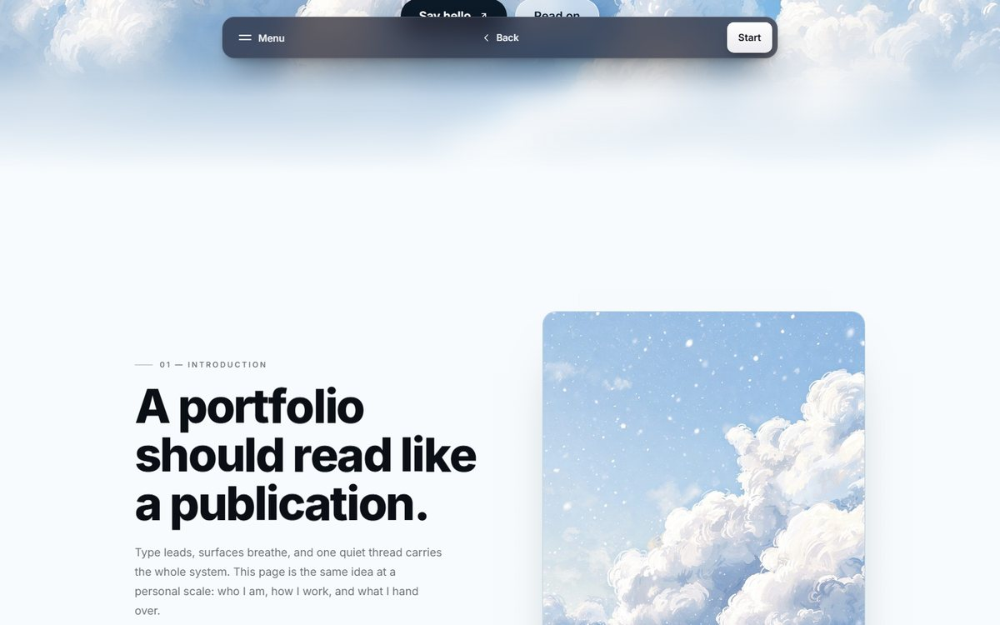
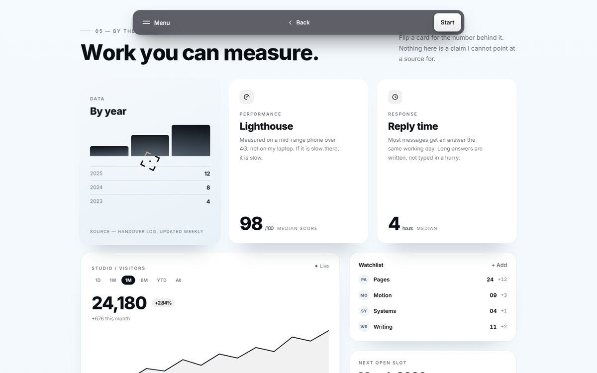

# idea-folio

**from imagination to a portfolio** —— 丢几张图进去，得到一个编辑设计风的个人站。

给 AI agent（DeepSeek Harness / Claude Skills 风格）用的技能包：把「用户的几张图」变成「一个两页、像素级稳定、可验收」的个人主页 / 作品集。




## 它产出什么

两页、6 个区块、8 个交互组件，全部可跑：

| 区块 | 内容 |
|---|---|
| `/` 欢迎页 | 全屏图 + 大字号 Welcome + 自定义四角光标 |
| 首屏 | 全屏图 + 标题 + 副文 + 两个按钮，底部模糊过渡进正文 |
| 01 Introduction | 左文右图 + 拆字动画 + 四组数字 |
| 02 How I work | 三步做法，细线分隔 |
| 03 Selected work | 可滑动作品卡（左图右文 + 点赞 + tag + 数据） |
| 04 Working together | 三条要点 + 动效文件列表 |
| 05 By the numbers | 三张可翻转数据卡 + 仪表盘（走势图 / 指标 / 活动流） |
| 06 Closing | 收尾 + 邮箱 + 通知铃铛 + 页脚 |

零输入也能出站：不带任何图片和文案，直接用内置默认值就是一条完整页面。

## 快速开始

```powershell
# 1. 复制模板
Copy-Item "assets\template" "D:\work\my-site" -Recurse

# 2. 装依赖
cd D:\work\my-site
npm install --registry=https://registry.npmmirror.com

# 3. 生成图片槽位（不带 --in 就用自带默认图）
python ..\..\scripts\images.py --project . --defaults ..\..\assets\defaults
#    用你自己的图：python ..\..\scripts\images.py --project . --in a.jpg b.jpg

# 4. 改文案：只改 src/content.js

# 5. 起服务
npm run dev     # http://127.0.0.1:5299

# 6. 验收
node ..\..\scripts\verify.mjs --url http://127.0.0.1:5299 --out shots
```

## 图片怎么处理

三种模式，都由 `scripts/images.py` 决定：

| 用户给几张 | 行为 |
|---|---|
| 0 张 | 用 `assets/defaults/` 里 6 张内置图 |
| 1 张 | 从这一张裁 6 个不同区域（全图 / 中部 / 左 / 中 / 右） |
| 3–5 张 | 按顺序填槽位，不够的用默认补 |

固定比例，**只裁切不拉伸**：`welcome` / `hero` 3:2，`detail` 4:5，`work-1..3` 4:3。

脚本还会采样首屏平均亮度：低于 0.55 时写 `tone: "dark"`，页面自动切白字 + 压暗遮罩。所以深色图也能用。

## 为什么能「一模一样」

模板里的 6700 行代码是**复制**过去的，不是让模型重新生成：

| 层 | 来源 | 稳定性 |
|---|---|---|
| 版式 / 组件 / CSS | 复制 `assets/template` | 字节级一致 |
| 图片 | 脚本裁切 | 比例固定，内容随用户图 |
| 首屏明暗 | 脚本算图亮度 | 由图片决定 |
| 文案 / 数字 | 模型生成 | 每次都不同 |
| 验收 | 10 条断言 | 必须全绿 |

## 目录

```
idea-folio/
├─ SKILL.md                 触发条件 + 流程 + 硬性规则
├─ references/
│  ├─ design-tokens.md      颜色 / 字号 / 间距 / 圆角 / 阴影
│  ├─ sections.md           7 个区块的结构与验收点
│  ├─ components.md         8 个组件的 props 速查
│  └─ pitfalls.md           踩过的坑与修法
├─ assets/
│  ├─ template/             可跑的 Vite + React 工程
│  ├─ defaults/             6 张内置默认图（0.89 MB）
│  └─ example/              零输入产出的完整样例 + 截图
└─ scripts/
   ├─ images.py             图片槽位裁切 + 亮度检测
   ├─ verify.mjs            10 条 CDP 验收 + 截图
   └─ init.ps1              一键复制 / 装依赖 / 起服务
```

## 环境要求

- Node.js 18+（模板用 Vite 5 / React 18）
- Python 3.9+，安装 Pillow（`pip install pillow`）
- 验收脚本需要 Chromium 内核浏览器（Edge 或 Chrome）

## 技术栈

React 18 · Vite 5 · GSAP 3（SplitText / ScrollTrigger）· motion 14 · Hugeicons

## License

MIT
